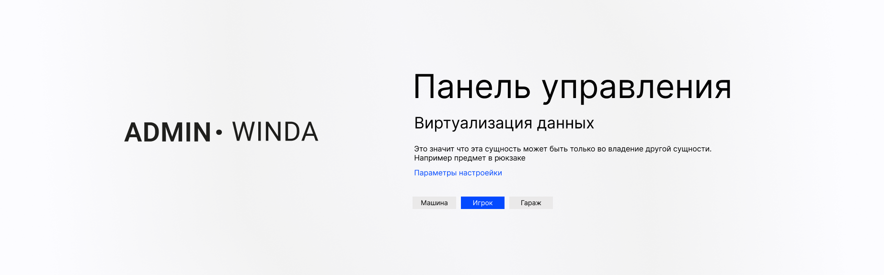

<p align="center">

</p>
 
## Admin Winda
Кароч изи пакет для админки. Просто тупо шаблон. Не каких функций, нефига нет.
   

## Установка
1) Установить из композера 
```  
composer require slavawins/adminwinda
```

2) Опубликовать js файлы, вью и миграции необходимые для работы пакета.
Вызывать команду:
   ```
   php artisan vendor:publish --provider="SlavaWins\AdminWinda\Providers\AdminWindaServiceProvider"
   php artisan vendor:publish --provider="SlavaWins\EasyAnalitics\Provid[AuthenticateAdmin.php](src%2Fcopy%2FMiddleware%2FAuthenticateAdmin.php)ers\EasyAnaliticsServiceProvider"
   ``` 


4) В роутере routes/web.php удалить:
 добавить
 ```
    use SlavaWins\AdminWinda\Library\AdminWindaRoute;
    Route::group(['middleware' => 'auth_admin'], function () { 
        AdminWindaRoute::routes(); 
    });
    
 ``` 

Что бы пользоватеься правами мидлвери, добавьте это в app\Http\Kernel.php
 ```
 protected $routeMiddleware = [
        'auth_admin' => \App\Http\Middleware\AuthenticateAdmin::class,
    
 ``` 

 <BR> Дотсуп пользвоателя к админке защищен middleware. И требует что у user был параметр is_admin=true
 <BR> Найти это можно в middleware - auth_admin. Можно найти его в Http/Middleware/AuthenticateAdmin.
<BR> Можно просто октлючить на крайняк


 Если вы хотите что бы адмника была не по адресу /admin то добавьте в енв это
 ```
   ADMIN_URL=xzrandomadminurl
 ``` 


5) Выполнить миграцию
 ```
    php artisan migrate 
 ``` 


## Документация

Шаблон админки, который строит список, карточку и аналитику для моделей `MPModel` (mrproperter) по классам-«представлениям».

### Подключение
```php
use SlavaWins\AdminWinda\Library\AdminWindaRoute;
Route::group(['middleware' => 'auth_admin'], fn () => AdminWindaRoute::routes());
```
Middleware `auth_admin` → `AuthenticateAdmin` (копия в `src/copy/Middleware`): пускает только `user->is_admin`, остальным отдаёт 404.
Префикс URL: `ADMIN_URL` в `.env` (по умолчанию `admin`).

### Роуты
| Метод | URL | Имя | Что |
|---|---|---|---|
| GET | `/admin` | `admin` | главная |
| GET | `/admin/model/{Represent}/list` | `admin.mpm.list` | список, `?s=` поиск по string/text, `?sort=&sortArrow=DESC` |
| GET | `/admin/model/{Represent}/edit/{id}` | `admin.mpm.edit` | карточка (`id=0` — создание) |
| POST | `/admin/model/{Represent}/edit/{id}/{tag}` | `admin.mpm.edit.post` | сохранение полей с тегом |
| GET | `/admin/model/{Represent}/analtitics` | `admin.mpm.analtitics` | круговые диаграммы по select/checkbox/multioption |
| POST | `/admin/model/{Represent}/delete/{id}` | `admin.mpm.delete` | удаление (если `isCanDelete`), нужен CSRF |
| POST | `/admin/model/{Represent}/copy/{id}` | `admin.mpm.copy` | копия (если `isCanCopy`), нужен CSRF |

Кнопки в списке: `<a href="..." approvedModal="Удалить?" approvedModal-method="POST">` — после подтверждения
`ApprovedModalController` (formbuilder) отправляет скрытую форму с `_token`. Сортировка `?sort=` — только по полям модели.
Значения в списке экранируются (`ParsingAdminBlade::MpmListAdminRenderValue`).

### Как добавить модель в админку
Создайте `app/Admin/Represents/BlogRepresent.php`:
```php
class BlogRepresent extends RepresentBase {
    public $title = "Блог";
    public $descr = "Статьи";
    public $iconGoogle = "article";      // Material Icons
    public $modelClass = Blog::class;    // наследник MPModel
    public $isCanDelete = true;
    public $ignoreTags = ['auth'];       // какие теги-вкладки не показывать
    public $inOnePage = 32;
    public function IsEnabled(): bool { return true; }
}
```
Все классы из этой папки сами появляются в сайдбаре. На карточке каждый тег полей модели становится отдельной формой. Подписи вкладок задаются в `$tagTitle`.

Ещё настройки: `$image` + `GetImagePreview($model)` (превью в списке), `$customUrlEdit`, `$isCanCreatedAuto`, `$isCanCreatedUrlCustom`, `$analiticsDiagramBySelect` / `$analiticsDiagramByMulitioptions` (`'auto'` или массив полей), `$analiticsDiagramByValuesVariant = ['estimate' => [1,2,3,4,5]]`.

### Расширение вьюх
`ParsingAdminBlade::GetAdminExtendByType('user-show')` ищет `resources/views/*/admin-extend/user-show.blade.php` во всех папках вьюх и подключает их. Так другие пакеты (например authsms) добавляют свои блоки на страницу пользователя. Примеры лежат в `src/copy/Views`.

Blade-компоненты: `<x-aw-card>`, `<x-aw-sidebtn>`.

Зависимости: `slavawins/mrproperter`, `formbuilder`, `easyapi`, `easyanalitics`.
